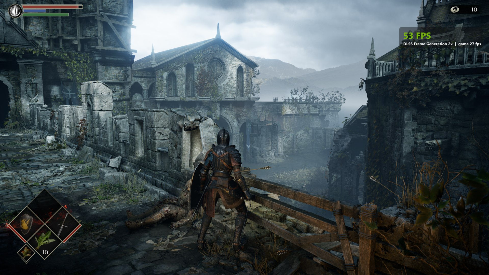
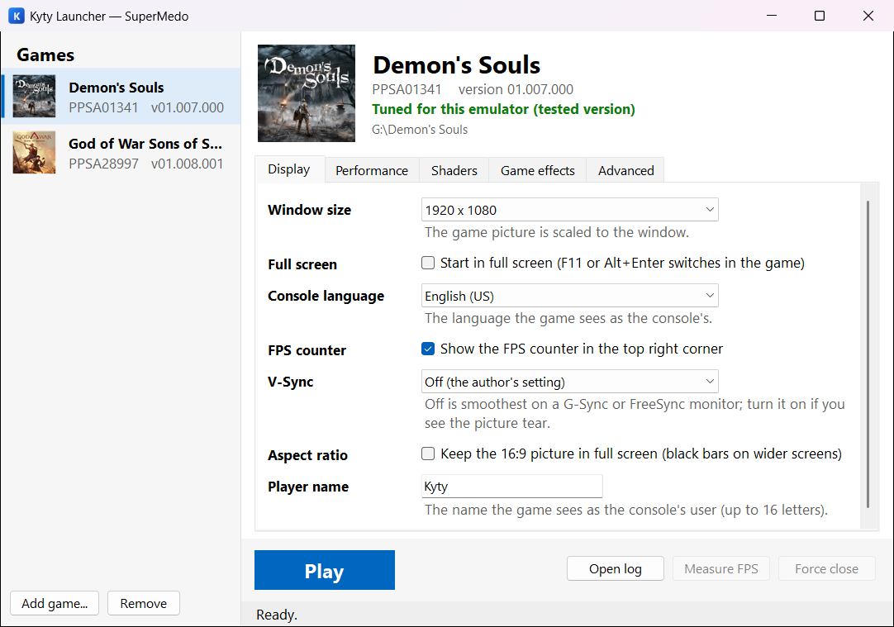
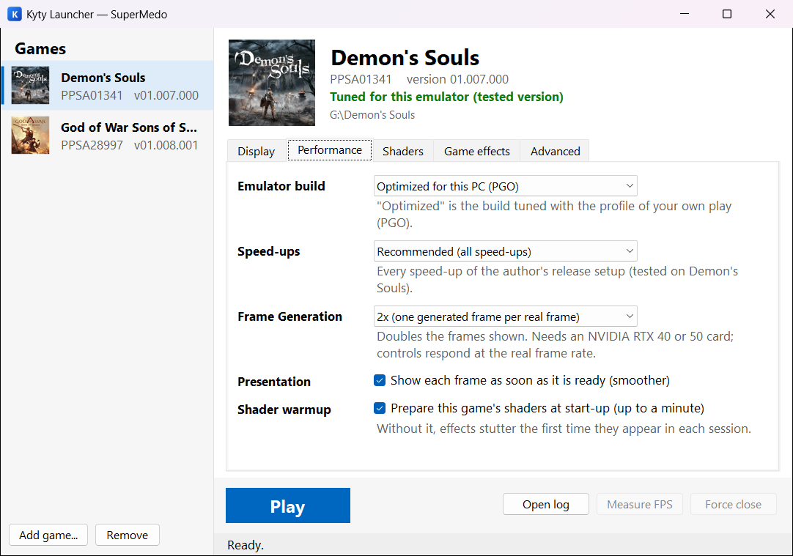
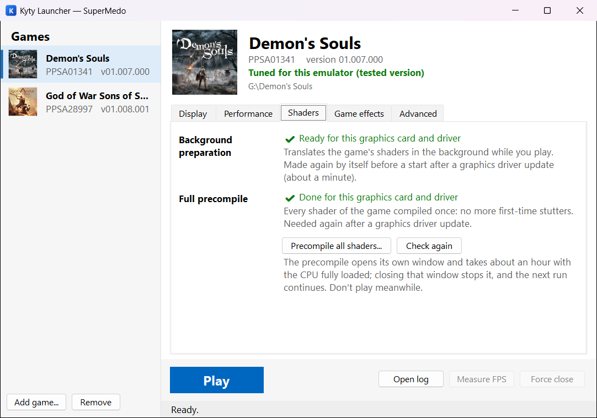
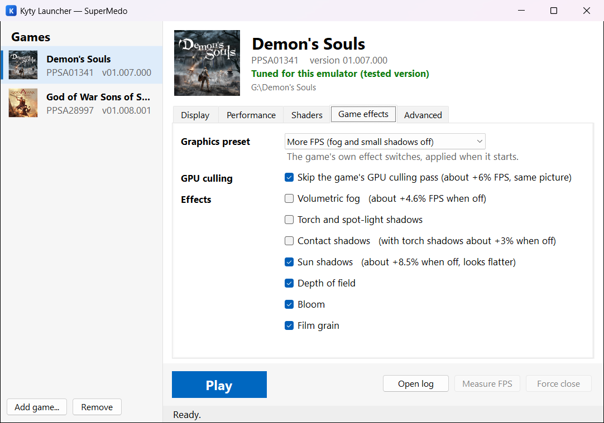

# KytyPS5 — SuperMedo version

**SuperMedo** is a version of the [KytyPS5](https://github.com/KytyPS5/KytyPS5) PlayStation 5 emulator,
built on [chenxiao07's Demon's Souls branch](https://github.com/chenxiao07/KytyPS5) for Windows, with
a game launcher and fixes for playing on Windows PCs.

**[Download the latest release](https://github.com/Supermedo/KytyPS5-SuperMedo/releases/latest)**


*Demon's Souls with DLSS Frame Generation 2x (RTX 5080, Ryzen 7 7800X3D).*

## Screenshots

| | |
|:---:|:---:|
|  |  |
| Game library and display settings | Optimized build, speed-ups and Frame Generation |
|  |  |
| Shader status and full precompile | Demon's Souls effect presets with their measured gains |

> [!IMPORTANT]
> Not affiliated with Sony Interactive Entertainment or PlayStation. No games, game files, system
> software or NVIDIA files are included. Use only game files you have obtained legally.

## What this version adds

**Kyty Launcher** (`tools/launcher`): a Windows app with a game library and settings per game.
- Games are read from their own files (name, version, cover).
- Display: window size, full screen, V-Sync, 16:9 in full screen, console language, player name, FPS counter.
- Performance: optimized or standard build, the speed-up switches ("Recommended" or "Safe"),
  DLSS Frame Generation (Demon's Souls), shader warmup.
- Shaders: the status of the background shader preparation and the full precompile, made again
  after a graphics driver update before a start; a "Precompile all shaders" button (Demon's Souls).
- Demon's Souls effects: presets (Full quality / More FPS / Max FPS) and single switches (fog,
  shadows, depth of field, bloom, film grain) with their measured gains.
- Advanced: red-zone protection, extra switches and arguments, game patch files.
- Play, Force close, Open log (the last 20 run logs are kept in `_Build\run-logs`) and
  Measure FPS (the real frame rate over 8 seconds while a game runs).

**Emulator fixes**
- DLSS Frame Generation starts on recent NVIDIA drivers: the driver's own 256 GiB reservation at
  Vulkan start-up took the address range the emulator leaves for it below 1 TiB
  (`src/local/driver-address-hole.h`).
- Sound no longer falls behind the picture in long sessions: non-blocking AudioOut2 pushes queue at
  most 100 ms for the audio device (`src/libs/audio.cpp`).
- A game pad that connects and disconnects quickly (Bluetooth sleep, Steam Input) no longer closes
  the game (`src/libs/controller.cpp`, `window.cpp`).
- `_umtx_op` waits with a timeout, from KytyPS5 upstream (`src/libs/libKernel.cpp`,
  `src/kernel/syncOnAddress.*`): needed by God of War Sons of Sparta.
- `precompile-windows.ps1` works with game folders whose names contain `[` `]`, and without Python in a
  release: the shader list (`precompile.py seeds`) is packed as `kyty_seeds.exe`
  (`tools/local/static-precompile/build-seeds-exe.ps1`).

**Game notes**
- *Demon's Souls* (PPSA01341 01.007.000): the game this branch is tuned for.
- *God of War Sons of Sparta* (PPSA28997 01.008.001): runs at its 60 fps cap with red-zone protection
  off (this branch's red-zone patcher breaks it; the launcher turns it off for every other game).

## Using a release

1. Download the zip from **Releases** and unpack it anywhere.
2. Install the Vulkan-capable graphics driver for your card (NVIDIA RTX with 12 GB or more recommended).
3. Start `KytyLauncher.exe`, choose **Add game...** and pick the game folder (the one with `eboot.bin`
   and `sce_sys`), then **Play**.
4. Demon's Souls: the first **Play** reads the game's list of shaders from your game files and prepares
   them for your graphics card (about two minutes, once; `kyty_seeds.exe` and `kyty_shader_precompile.exe`).
   For no first-time stutters at all, run **Shaders → Precompile all shaders** once (about an hour).

Requirements: Windows 10/11 64-bit, a CPU with AVX2, 32 GB of RAM (with a system-managed page file).

**DLSS Frame Generation** (Demon's Souls, NVIDIA RTX 40/50) needs NVIDIA's Streamline SDK, which may
not be redistributed: download it from [NVIDIA-RTX/Streamline](https://github.com/NVIDIA-RTX/Streamline/releases)
and copy its `bin\x64` folder to `streamline\bin\x64` next to `kyty_emulator.exe`.

## Building from source

The upstream instructions in [README.md](README.md) apply (Windows: `build-windows.cmd`). The launcher
needs the .NET 8 SDK:

```
dotnet publish tools\launcher\KytyLauncher.csproj -c Release -r win-x64 -p:PublishSingleFile=true -o tools\launcher\publish
```

Put `KytyLauncher.exe` in the emulator folder (next to `_Build`, or next to `kyty_emulator.exe`).
The shader tools: `build-windows.cmd kyty_shader_precompile`, and
`tools\local\static-precompile\build-seeds-exe.ps1` for `kyty_seeds.exe` (needs Python 3).
For Frame Generation in a source build, unpack the Streamline SDK to `_Build\deps\streamline\sdk`
before configuring.

## License

GPL-2.0, like KytyPS5 (see [LICENSE](LICENSE)).
